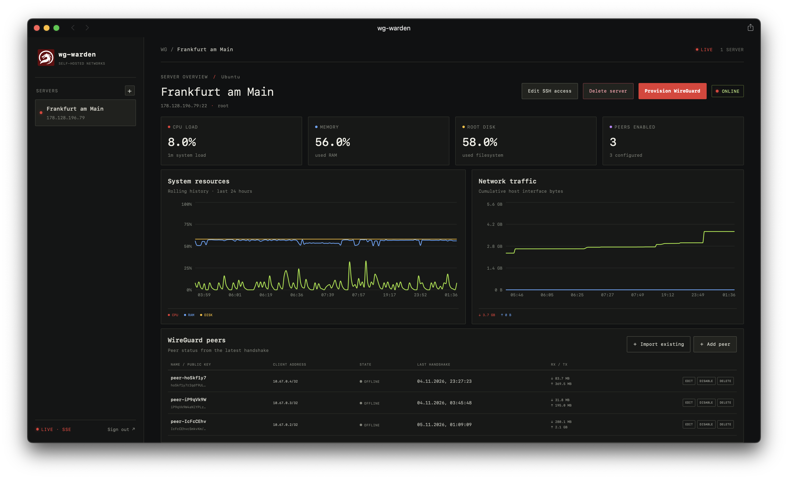

# wg-warden

Self-hosted панель управления WireGuard-серверами. Подключайте свои VPS на Ubuntu или Debian по SSH, устанавливайте WireGuard, создавайте профили клиентов и следите за состоянием серверов в одном веб-интерфейсе.

wg-warden запускается локально через Docker Compose или на собственном VPS (по домену с HTTPS либо по IP). Это не VPN-хостинг: VPS и SSH-доступ к нему предоставляет пользователь. Клиентский VPN-трафик идёт напрямую между устройствами и вашим VPS и не проходит через wg-warden.



## Содержание

- [Возможности](#возможности)
- [Как это устроено](#как-это-устроено)
- [Быстрый старт: локальный запуск](#быстрый-старт-локальный-запуск)
- [Установка на VPS](#установка-на-vps)
- [Подключение управляемого VPS](#подключение-управляемого-vps)
- [Настройки](#настройки)
- [Резервные копии](#резервные-копии)
- [Разработка](#разработка)
- [API](#api)
- [Безопасность](#безопасность)

## Возможности

**Серверы и WireGuard**
- Добавление VPS по SSH: пароль или приватный ключ (в том числе с passphrase).
- Запоминание SSH host key после первого успешного подключения.
- Установка и настройка WireGuard на Ubuntu и Debian. Управляемый интерфейс называется `wg-warden0`.

**Клиенты (peers)**
- Создание, включение, отключение, удаление и импорт peers.
- Лимиты трафика и времени использования peer.
- Одноразовый клиентский файл `.conf` и QR-код. Приватный ключ клиента приложением не сохраняется.

**Мониторинг**
- CPU, память, корневой диск и сетевой трафик сервера.
- Трафик peers и время последнего handshake.
- Графики истории и обновление статусов в реальном времени через SSE.

**Прочее**
- Регистрация и вход с JWT-аутентификацией.
- Все данные хранятся в вашем PostgreSQL.

## Как это устроено

```text
Браузер → [Caddy: HTTPS, только на VPS с доменом] → Nginx / React → Spring Boot API → PostgreSQL
                                                                           │
                                                                           └── SSH → ваш VPS с Ubuntu или Debian
```

Nginx отдаёт собранный frontend и перенаправляет API-запросы в Spring Boot. Backend хранит данные в PostgreSQL, а для настройки WireGuard и сбора метрик подключается к вашим VPS по SSH.

| Часть | Технологии |
| --- | --- |
| Backend | Java 21, Spring Boot, Spring Security, Spring Data JPA |
| База данных | PostgreSQL 16, Flyway |
| SSH | Apache MINA SSHD |
| Секреты | AES-256-GCM, ключ `APP_MASTER_KEY` |
| Аутентификация | JWT, пароли хешируются Argon2 |
| Frontend | React 19, TypeScript, Vite, TanStack Query, Recharts, Tailwind CSS |
| QR-коды | ZXing |
| Запуск | Docker Compose, Nginx, Caddy (HTTPS на VPS) |

## Быстрый старт: локальный запуск

### Требования

- Docker Desktop (macOS, Windows) либо Docker Engine с Compose v2 (Linux).
- Bash, `curl` и OpenSSL. В macOS и большинстве Linux-дистрибутивов они уже есть.
- В Windows команды запускаются из WSL2 с включённой интеграцией Docker Desktop.

Java, Maven, Node.js и PostgreSQL отдельно ставить не нужно.

### Установка

```bash
git clone https://github.com/egorparahovnik/wg-warden.git
cd wg-warden
./install.sh
```

Скрипт проверит Docker, создаст `.env`, сгенерирует ключ шифрования и JWT-секрет, соберёт образы, запустит приложение и проверит его состояние. Первый запуск может занять несколько минут.

После установки откройте **http://localhost:8080**, зарегистрируйтесь и войдите. Порт меняется переменной `WEB_PORT` в `.env`. PostgreSQL доступен только с этого компьютера на порту `5432`, поэтому убедитесь, что порт свободен.

### Управление

```bash
./service.sh start     # запустить
./service.sh stop      # остановить
./service.sh status    # проверить состояние
./service.sh logs      # посмотреть логи
```

Сервис работает в фоне и поднимается вместе с Docker, пока его не остановили командой `stop`. Свернуть или закрыть окно Docker Desktop можно, а выход из Docker Desktop остановит контейнеры.

Обновление:

```bash
git pull
./install.sh
```

## Установка на VPS

Панель можно поднять на собственном сервере. Это удобно, когда нужен постоянный мониторинг и доступ с любых устройств. Локальный запуск при этом не затрагивается.

| Режим | Файл | Доступ | Когда подходит |
| --- | --- | --- | --- |
| **С доменом** (рекомендуется) | `docker-compose.tls.yml` | `https://ваш-домен` | постоянная работа |
| **По IP** | `docker-compose.vps.yml` | `http://<IP>` | проверка и временный доступ |

Режим выбирается автоматически: если в `.env.vps` заполнен `APP_DOMAIN`, поднимается HTTPS через Caddy, если пуст, панель доступна по IP.

В обоих режимах PostgreSQL доступен только внутри Docker-сети, контейнерам заданы лимиты памяти, а размер логов ограничен.

> [!WARNING]
> В режиме «по IP» трафик не шифруется. В открытом виде передаются пароль панели, JWT и всё, что вы вводите в форме: SSH-пароли и приватные ключи серверов, а также клиентские профили WireGuard. Используйте его только для проверки, а для постоянной работы подключите домен.

### Требования

- Ubuntu 22.04/24.04 или Debian 12, 1 ГБ RAM (лучше 2 ГБ), 10 ГБ диска.
- Открытые порты: SSH и 80/443 для HTTPS (или только 80 для доступа по IP).
- Для HTTPS: домен или поддомен с A-записью на IP этого VPS.
- Docker установщик поставит сам.

### 1. Подготовка чистого сервера

<details>
<summary>Один раз на новом VPS: пользователь, обновление, firewall, SSH</summary>

**Пользователь.** Работать под root не нужно: создайте пользователя с `sudo` и перенесите в него SSH-ключ.

```bash
adduser wgwarden
usermod -aG sudo wgwarden
rsync --archive --chown=wgwarden:wgwarden ~/.ssh /home/wgwarden
```

Дальше подключайтесь как `ssh wgwarden@<IP>`.

**Обновление системы и пакеты.**

```bash
sudo apt update && sudo apt full-upgrade -y
sudo apt install -y curl git ca-certificates ufw
```

**Firewall.** Наружу нужны только SSH и порты панели. Порты PostgreSQL (`5432`) и backend (`8081`) не публикуются, открывать их не надо.

```bash
sudo ufw allow OpenSSH
sudo ufw allow 80/tcp     # HTTP: проверка домена и редирект на HTTPS
sudo ufw allow 443/tcp    # HTTPS (только при использовании домена)
sudo ufw enable
sudo ufw status
```

Без домена панель слушает один порт (`WEB_PORT`, по умолчанию 80), и достаточно `sudo ufw allow 80/tcp`. Если у провайдера есть свой firewall (Hetzner, Oracle, AWS, Vultr, DigitalOcean), откройте те же порты и там: `ufw` его не заменяет.

**SSH.** Убедившись, что вход по ключу работает, создайте `/etc/ssh/sshd_config.d/99-hardening.conf`:

```text
PermitRootLogin no
PasswordAuthentication no
```

Затем выполните `sudo systemctl reload ssh`.

**Swap.** Если RAM меньше 2 ГБ и swap нет, установщик создаст swap-файл на 2 ГБ: без него сборка образов может завершиться по нехватке памяти. После установки swap лучше оставить включённым (проверка: `free -h`).

</details>

### 2. Установка

```bash
ssh wgwarden@<IP>
git clone https://github.com/egorparahovnik/wg-warden.git
cd wg-warden
./deploy/vps-install.sh
```

Скрипт установит Docker (если его нет), создаст swap при необходимости, сгенерирует секреты в `.env.vps`, последовательно соберёт образы и дождётся health-check. На слабом VPS первая сборка занимает 5-15 минут. В конце скрипт напечатает адрес панели.

Если порт 80 занят, задайте в `.env.vps` `WEB_PORT=8080` и запустите установку снова.

### 3. HTTPS с доменом

1. Направьте A-запись домена на IP сервера и дождитесь, пока она начнёт резолвиться: `dig +short panel.example.com`.
2. Укажите домен и запустите установку ещё раз:

```bash
sed -i 's|^APP_DOMAIN=.*|APP_DOMAIN=panel.example.com|' .env.vps
./deploy/vps-install.sh
```

Caddy сам выпустит сертификат Let's Encrypt и будет его продлевать, а HTTP-запросы будут перенаправляться на HTTPS. Сертификаты лежат в Docker volume `wg-warden_caddy_data` и переживают перезапуск контейнеров. Порты 80 и 443 должны быть открыты и в firewall провайдера.

Порты Caddy меняются через `HTTP_PORT` и `HTTPS_PORT`, но с Let's Encrypt их лучше не трогать: проверка домена идёт через порт 80. Чтобы сменить домен, поменяйте `APP_DOMAIN` и запустите установку снова.

Шифрование без домена возможно: задайте `APP_DOMAIN=<IP-VPS>` и `TLS_MODE=internal`. Caddy выпустит самоподписанный сертификат, трафик будет зашифрован, но браузер покажет предупреждение о недоверенном сертификате.

### 4. Первая регистрация

Регистрация по умолчанию закрыта (`APP_REGISTRATION_ENABLED=false`), но пока в базе нет пользователей, `/api/auth/register` работает. После создания первого аккаунта регистрация закрывается автоматически: `/api/auth/register` отвечает `403`, а вход продолжает работать.

Поэтому зарегистрируйтесь сразу после установки, пока адрес панели никому не известен. Чтобы позже добавить второго пользователя, задайте `APP_REGISTRATION_ENABLED=true`, выполните `./deploy/vps-service.sh restart`, а после регистрации верните `false`.

### Управление и обновление

```bash
./deploy/vps-service.sh {start|stop|restart|status|logs}
./deploy/vps-backup.sh                  # резервная копия
git pull && ./deploy/vps-install.sh     # обновление
```

`restart` пересоздаёт контейнеры с текущими значениями из `.env.vps` и переключает стек, если `APP_DOMAIN` появился или изменился. Перед обновлением рекомендуется сделать резервную копию.

### Особенности VPS-стека

- Профиль `prod` отключает Swagger и публикует только `/actuator/health`.
- PostgreSQL не публикует порт на хост и настроен на небольшой объём памяти.
- База на VPS создаётся с нуля, данные с локальной машины не переносятся. Для переноса сохраните `.env` (тот же `APP_MASTER_KEY`) и дамп базы.

## Подключение управляемого VPS

Эти шаги одинаковы для локального и VPS-режимов.

1. Нажмите **Add server** и укажите название, публичный IP или DNS-имя, SSH-порт и пользователя.
2. Введите пароль SSH либо приватный ключ (и passphrase, если ключ защищён).
3. Панель проверит SSH-доступ и определит ОС. Установка WireGuard поддерживается на Ubuntu и Debian.
4. Нажмите **Provision WireGuard**.
5. В разделе peers создайте клиента и сохраните `.conf` либо отсканируйте QR-код в официальном приложении WireGuard.

Файл и QR-код содержат приватный ключ клиента и показываются один раз. Храните их как секреты.

### Права sudo

Панель выполняет команды на управляемом VPS через `sudo -n`, то есть без запроса пароля. Пароль SSH используется только для входа. Если у пользователя обычный sudo с паролем, при добавлении сервера появится `Server connection failed`, а в мониторинге ошибка `sudo: a password is required`.

Варианты:

- **Для теста:** добавлять сервер под `root` с SSH-ключом (в Ubuntu `PermitRootLogin prohibit-password` разрешает вход по ключу).
- **Рекомендуется:** отдельный пользователь с sudo без пароля. На управляемом VPS:

```bash
echo 'deploy ALL=(ALL) NOPASSWD: ALL' | sudo tee /etc/sudoers.d/wg-warden
sudo chmod 440 /etc/sudoers.d/wg-warden
sudo visudo -c                              # проверить синтаксис
sudo -n true && echo "sudo -n работает"     # выполнять от имени этого пользователя
```

Для постоянной работы замените `ALL` на список нужных команд (`wg`, `wg-quick`, `systemctl`, `apt-get`, `tee` и т. д.).

### Порт WireGuard

Интерфейс `wg-warden0` поднимается на UDP-порту `51821`. Если на управляемом VPS включён `ufw`, установка сама добавит правило `ufw allow 51821/udp`. Проверка:

```bash
sudo ufw status | grep 51821
sudo wg show
```

Если у провайдера есть внешний firewall (Security Group, Cloud Firewall), откройте там входящий UDP 51821. Без открытого порта клиент подключается, но handshake не проходит.

## Настройки

Установщик создаёт `.env` (локальный запуск) или `.env.vps` (VPS) со следующими переменными.

| Переменная | Где | Назначение |
| --- | --- | --- |
| `APP_MASTER_KEY` | везде | AES-ключ в Base64 для шифрования SSH- и WireGuard-секретов |
| `JWT_SECRET` | везде | Ключ подписи токенов входа |
| `DB_USER`, `DB_PASSWORD` | везде | Учётные данные PostgreSQL (имя базы и пользователя по умолчанию: `wgwarden`) |
| `WEB_PORT` | везде | Порт веб-интерфейса: `8080` локально, `80` на VPS без домена |
| `PGDATA_VOLUME` | везде | Docker volume с данными PostgreSQL (на VPS по умолчанию `wg-warden_vps_pgdata`) |
| `MONITORING_INTERVAL` | везде | Интервал опроса VPS, по умолчанию `60s` |
| `APP_DOMAIN` | VPS | Домен панели: заполнен, значит включается HTTPS через Caddy |
| `TLS_MODE` | VPS | `acme` (Let's Encrypt) или `internal` (самоподписанный сертификат) |
| `HTTP_PORT`, `HTTPS_PORT` | VPS | Порты Caddy, по умолчанию `80` и `443` |
| `APP_REGISTRATION_ENABLED` | VPS | `false` по умолчанию. Первый аккаунт на пустой базе создать можно, `true` открывает регистрацию всем |
| `BACKUP_KEEP` | VPS | Сколько резервных копий хранить, по умолчанию `7` |

> [!IMPORTANT]
> Не генерируйте новый `APP_MASTER_KEY` после того, как секреты уже сохранены: они не расшифруются другим ключом. Файлы `.env` и `.env.vps` исключены из Git. Установщик распознаёт имя volume прежней версии проекта и подключает его при обновлении, чтобы приложение не переключилось на пустую базу.

## Резервные копии

В базе лежат зашифрованные SSH-пароли и приватные ключи WireGuard. Чтобы их расшифровать, нужен `APP_MASTER_KEY` из того же окружения. Поэтому для восстановления нужны и дамп, и соответствующий `.env`/`.env.vps`. Храните их вне сервера, в защищённом месте: тот, кто получит оба файла, получит и доступ к секретам.

### На VPS

`./deploy/vps-backup.sh` снимает дамп базы (`pg_dump --clean --if-exists`) и копию `.env.vps` в папку `backups/`, оставляя последние 7 копий.

```bash
./deploy/vps-backup.sh
scp wgwarden@<IP>:~/wg-warden/backups/* ./     # забрать копии с сервера
```

Восстановление заменяет текущие данные и просит подтверждение:

```bash
./deploy/vps-restore.sh backups/wg-warden-20260101-120000.sql.gz
```

Ежедневная копия по cron:

```cron
30 3 * * * cd /home/wgwarden/wg-warden && ./deploy/vps-backup.sh >> backups/backup.log 2>&1
```

### Локально

```bash
mkdir -p backups
docker compose exec -T db pg_dump -U wgwarden -d wgwarden > "backups/wg-warden-$(date +%F).sql"
```

Восстановление в запущенную базу:

```bash
docker compose exec -T db psql -U wgwarden -d wgwarden < backups/имя-файла.sql
```

### Остановка и удаление (локально)

`./service.sh stop` останавливает приложение, сохраняя контейнеры и данные. Чтобы удалить контейнеры и сеть, но оставить базу:

```bash
docker compose down
```

Удаление volume базы безвозвратно уничтожит пользователей, серверы, peers и метрики. Перед этим сделайте резервную копию.

## Разработка

### Требования

- JDK 21
- Docker с Compose v2 (для PostgreSQL и Testcontainers)
- Node.js 20+ и npm

### Запуск

Создайте `.env` и заполните оба секрета случайными значениями:

```bash
cp .env.example .env
openssl rand -base64 32    # значение для APP_MASTER_KEY
openssl rand -base64 48    # значение для JWT_SECRET
```

Запустите базу, затем backend и frontend в отдельных терминалах:

```bash
docker compose up -d db
```

```bash
./mvnw spring-boot:run -Dspring-boot.run.profiles=dev
```

```bash
cd frontend
npm ci
npm run dev
```

Frontend доступен по адресу **http://localhost:5173**, Vite перенаправляет API-запросы на backend (**http://localhost:8081**). Профиль `dev` использует фиксированные тестовые секреты, поэтому не применяйте его с реальными данными.

### Тесты

Нужен работающий Docker: интеграционные тесты поднимают PostgreSQL через Testcontainers.

```bash
./mvnw test
```

## API

Интерактивная документация (Swagger UI) доступна по адресу **http://localhost:8081/swagger-ui.html**, пока backend запущен в профиле `dev`. В профиле `prod` Swagger отключён.

| Маршруты | Назначение |
| --- | --- |
| `/api/auth/register`, `/api/auth/login` | Регистрация и получение JWT |
| `/api/me` | Данные авторизованного пользователя |
| `/api/servers` | Просмотр, добавление, изменение и удаление серверов |
| `/api/servers/{id}/provisioning/wireguard` | Установка WireGuard на сервер |
| `/api/servers/{id}/peers`, `/api/peers/{id}` | Управление peers и создание одноразовых профилей |
| `/api/servers/{id}/metrics`, `/api/peers/{id}/metrics` | История метрик |
| `/api/events` | События статусов и метрик в реальном времени (SSE) |

Для всех запросов, кроме регистрации, входа, health-check и документации, нужен заголовок `Authorization: Bearer <JWT>`.

## Безопасность

- Панель хранит SSH-доступ к вашим серверам, поэтому берегите её как критичный сервис: компрометация панели означает доступ к управляемым VPS.
- Для доступа из интернета используйте только HTTPS (домен и Caddy). Режим «по IP» передаёт всё открытым текстом.
- Используйте отдельного SSH-пользователя с ограниченными правами `sudo`.
- Приложение запоминает SSH host key при первом успешном подключении.
- Секреты в базе шифруются AES-256-GCM, а для расшифровки нужен `APP_MASTER_KEY`, который хранится вне базы.
- Не публикуйте `.env`, `.env.vps`, резервные копии, SSH-данные и клиентские профили WireGuard.
- Профиль `dev` содержит тестовые секреты и не предназначен для реальных данных.

---